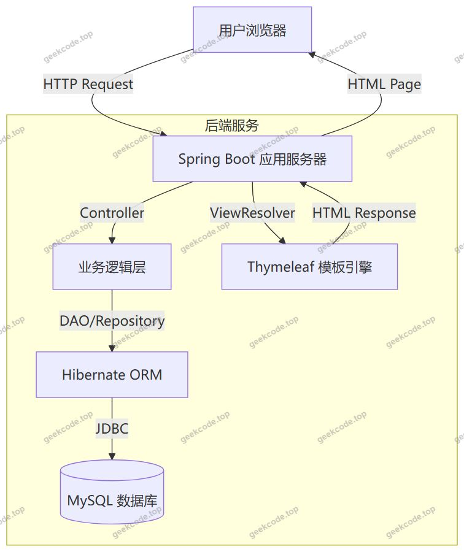
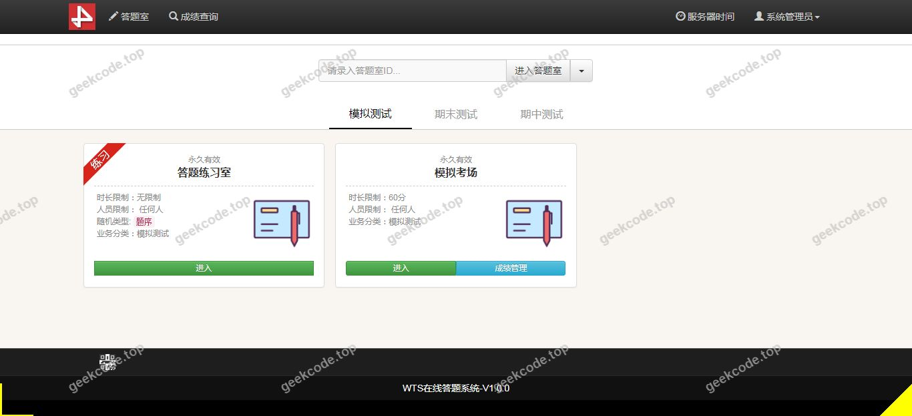
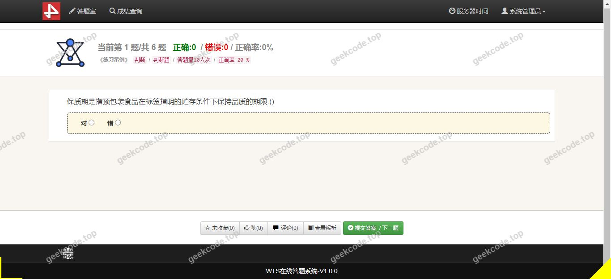
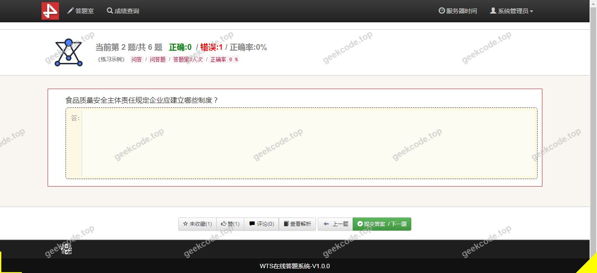
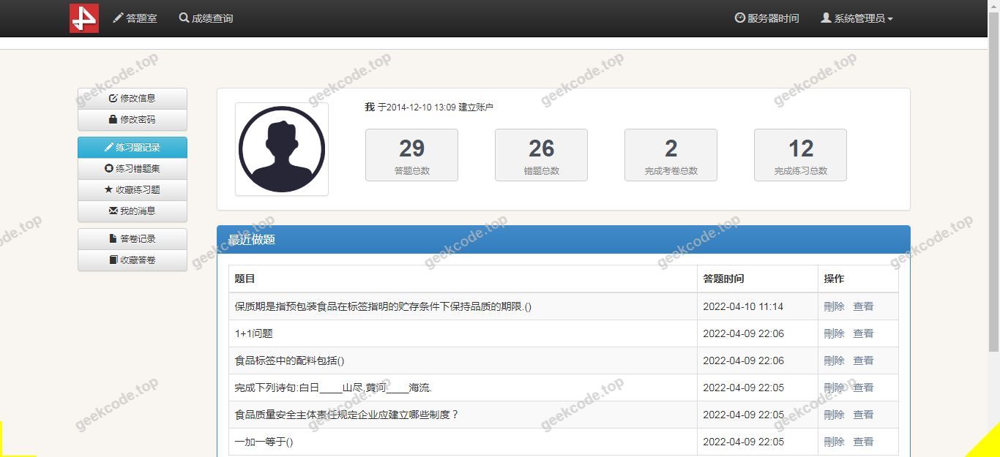
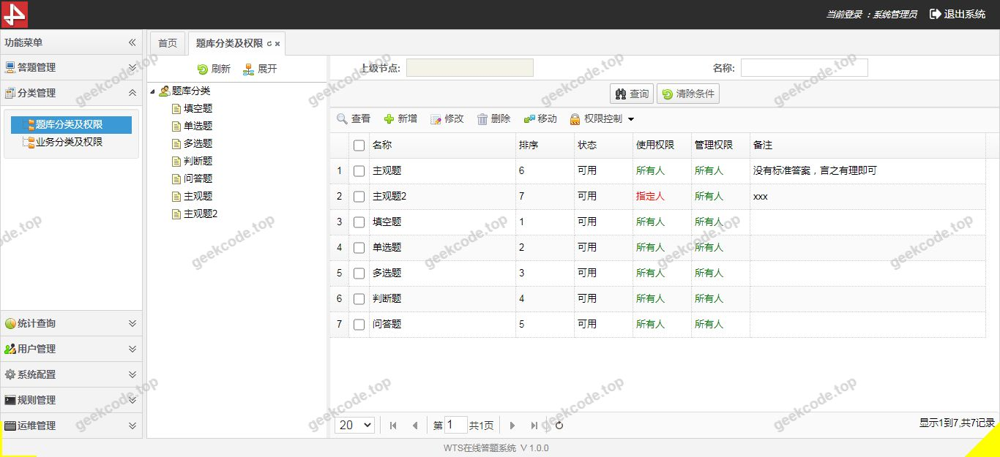
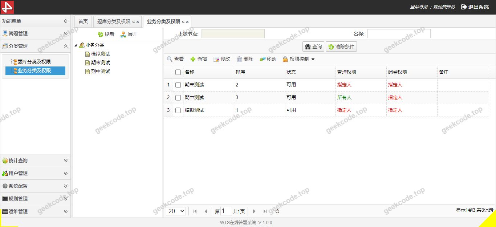
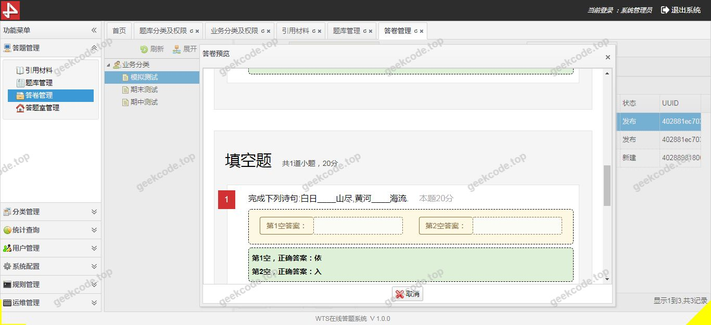

# java精品项目-基于spring+springmvc+hibernate的在线问卷答题系统【毕业设计】

> 🎓 **计算机毕业设计 · java精品项目-基于spring+springmvc+hibernate的在线问卷答题系统【毕业设计】**
>
> 本仓库只放**项目介绍 + 运行截图**（截图是站点带水印的原图，存在仓库 `images/` 里）。
>
> 👉 **完整可运行源码 / 数据库脚本 / 部署文档：[点我获取](https://geekcode.top/archives/java%E7%B2%BE%E5%93%81%E9%A1%B9%E7%9B%AE-%E5%9F%BA%E4%BA%8Espring-springmvc-hibernate%E7%9A%84%E5%9C%A8%E7%BA%BF%E9%97%AE%E5%8D%B7%E7%AD%94%E9%A2%98%E7%B3%BB%E7%BB%9F%E3%80%90%E6%AF%95%E4%B8%9A%E8%AE%BE%E8%AE%A1%E3%80%91?utm_source=github)**
>
> 💬 咨询微信：**ir9372**　|　🌐 更多项目：[极客代码 geekcode.top](https://geekcode.top/?utm_source=github)
>
> 📌 项目详情页：<https://geekcode.top/archives/java%E7%B2%BE%E5%93%81%E9%A1%B9%E7%9B%AE-%E5%9F%BA%E4%BA%8Espring-springmvc-hibernate%E7%9A%84%E5%9C%A8%E7%BA%BF%E9%97%AE%E5%8D%B7%E7%AD%94%E9%A2%98%E7%B3%BB%E7%BB%9F%E3%80%90%E6%AF%95%E4%B8%9A%E8%AE%BE%E8%AE%A1%E3%80%91?utm_source=github>

<table><td width="230" align="center"> <b>扫码加微信 ir9372</b></td><td valign="middle">📦 源码 = 项目介绍 + 全部运行截图 + 数据库 + 部署文档 👉 点上方任意截图，直接跳到 <b>极客代码 geekcode.top</b> 详情页</td></table>

---

<h1>java精品项目-基于spring+springmvc+hibernate的在线问卷答题系统【毕业设计】</h1>
<h2>项目概述</h2>

本项目为“基于 Spring + Spring MVC + Hibernate 的在线问卷答题系统”，旨在构建一个轻量级、高效的 Web 端问卷调查与数据收集平台。系统核心功能围绕在线问卷的创建、发布、用户答题及结果展示展开，适用于学校教学反馈、企业内部调研或小型社区意见收集等场景。虽然项目名称提及传统 SSM（Spring, Spring MVC, Hibernate）架构，但实际技术栈基于 <strong>Spring Boot</strong> 框架实现，以简化配置并提升开发效率。系统采用服务端渲染模式，通过 Thymeleaf 模板引擎生成前端页面，后端直接处理业务逻辑与数据库交互，无需独立的前端工程化构建流程。主要服务对象包括问卷发布者（管理员/教师）和答卷者（学生/用户），致力于解决传统纸质问卷统计繁琐、数据分析滞后的痛点。

<h2>技术架构</h2>

本系统采用经典的 B/S（浏览器/服务器）架构，基于 Java 语言开发，利用 Spring Boot 作为基础框架整合各项组件。

<ol>
<li><strong>后端架构</strong>：</li>
</ol>
<ul>
<li><strong>核心框架</strong>：使用 <strong>Spring Boot</strong> 快速搭建应用骨架，自动配置 Tomcat 容器，简化了 XML 配置文件的使用。</li>
<li><strong>持久层</strong>：集成 <strong>Hibernate</strong> ORM 框架，通过实体类映射数据库表结构，实现对象关系映射，减少手动编写 SQL 语句的工作量，提高代码的可维护性。</li>
<li><strong>视图层</strong>：采用 <strong>Thymeleaf</strong> 模板引擎进行服务端页面渲染。所有页面逻辑均在服务器端完成，最终生成 HTML 返回给浏览器，符合传统 MVC 设计模式。</li>
<li><strong>控制层</strong>：使用 Spring MVC 处理 HTTP 请求路由，将用户操作分发至对应的 Controller 进行处理。</li>
</ul>
<ol start="2">
<li><strong>数据库设计</strong>：</li>
</ol>
<ul>
<li>选用 <strong>MySQL</strong> 作为关系型数据库管理系统，存储问卷元数据、题目信息、选项内容以及用户的答题记录。</li>
<li>数据库连接池由 Spring Boot 默认管理（通常为 HikariCP 或 Druid），确保高并发下的连接稳定性。</li>
</ul>
<ol start="3">
<li><strong>技术选型理由</strong>：</li>
</ol>
<ul>
<li>Spring Boot 提供了“约定优于配置”的开发体验，适合毕业设计快速迭代。</li>
<li>Hibernate 屏蔽了底层 SQL 细节，便于开发者聚焦于业务逻辑建模。</li>
<li>Thymeleaf 与 Spring Boot 无缝集成，支持自然模板语法，方便非专业前端人员维护页面样式。</li>
</ul>

<h2>功能模块</h2>

根据提供的截图列表（系统运行界面1-8）及项目类型（无独立前台/后台路由区分，均为 Front 视角），系统功能主要体现为用户交互界面。由于缺乏具体的后台管理菜单定义，以下功能模块基于“在线问卷答题系统”的核心业务逻辑及可见的运行界面进行推导：

<h3>1. 问卷浏览与选择模块</h3>
<ul>
<li><strong>功能描述</strong>：展示当前可用的在线问卷列表。用户进入系统后，首先看到的是问卷首页或列表页，显示问卷标题、简介及状态。</li>
<li><strong>对应界面</strong>：可能对应截图中的初始加载页面或列表展示页。</li>
</ul>
<h3>2. 在线答题模块</h3>
<ul>
<li><strong>功能描述</strong>：这是系统的核心交互区域。用户点击具体问卷后，进入答题页面。页面动态渲染题目（单选、多选、填空等），提供选项勾选、文本输入框等控件。</li>
<li><strong>对应界面</strong>：对应截图中包含表单元素、题目编号及选项按钮的页面。</li>
</ul>
<h3>3. 提交与确认模块</h3>
<ul>
<li><strong>功能描述</strong>：用户在完成所有题目作答后，点击提交按钮。系统对必填项进行校验，防止漏填。提交成功后，向用户展示“提交成功”提示或感谢页面。</li>
<li><strong>对应界面</strong>：对应截图中带有“提交”、“确定”按钮或成功提示信息的页面。</li>
</ul>
<h3>4. 结果查看模块（推测）</h3>
<ul>
<li><strong>功能描述</strong>：部分问卷系统在提交后会即时展示个人答案回顾或简单的统计图表。鉴于有8张运行截图，可能包含答题进度条、上一题/下一题导航或结果预览。</li>
<li><strong>对应界面</strong>：对应截图中可能存在的数据展示或导航控件区域。</li>
</ul>
<blockquote>

<strong>注意</strong>：由于项目明确标注“是否有前台: 否”、“是否有后台: 否”，且仅提供“front”类型的截图，这意味着系统可能是一个单角色视角的演示版本，或者前后台功能未通过独立的 URL 路径严格隔离，而是通过同一套 Thymeleaf 模板根据不同权限渲染不同内容。现有信息无法确定是否存在独立的“管理员问卷编辑”界面。

</blockquote>
<h2>用户角色与权限</h2>

根据现有信息，系统仅展示了面向终端用户的“系统运行界面”。项目中未明确列出多角色管理菜单或登录入口的不同分支。因此，基于最小权限原则和可见功能，主要涉及以下角色：

<h3>1. 普通用户（答卷者）</h3>
<ul>
<li><strong>访问权限</strong>：</li>
<li>浏览公开的问卷列表。</li>
<li>填写并提交问卷答案。</li>
<li>查看答题过程中的导航与提示信息。</li>
<li><strong>限制</strong>：无法修改问卷题目、无法删除他人数据、无法查看原始数据库结构。</li>
</ul>
<h3>2. 系统管理员（隐含角色）</h3>
<ul>
<li><strong>现状说明</strong>：<strong>根据现有信息无法确定</strong>。</li>
<li><strong>分析</strong>：虽然项目名称为“在线问卷答题系统”，理论上需要管理员来创建和维护问卷。但提供的上下文明确指出“是否有后台: 否”且无后台路由列表。这可能意味着：</li>
</ul>
<ol>
<li>管理员功能未在演示截图或当前版本中体现。</li>
<li>管理员与普通用户使用相同的界面，通过不同的 Session 状态隐藏/显示特定按钮（如“新建问卷”）。</li>
<li>该系统仅为一个只读的答题演示原型，数据预置在数据库中，不包含动态增删改查的管理界面。</li>
</ol>

鉴于严禁编造未提及功能，此处不详细描述管理员的具体操作菜单，仅指出其存在性在当前文档证据链中缺失。

<h2>项目特色与创新点</h2>
<ol>
<li>
<strong>全栈一体化服务端渲染</strong>：
   区别于当下流行的前后端分离（Vue/React + RESTful API）模式，本项目回归经典的服务端渲染（SSR）架构。利用 Thymeleaf 直接在服务器端组装 HTML，降低了前端 JavaScript 的复杂度，对于毕业设计而言，更易于调试页面布局和逻辑绑定，体现了对传统 Java Web 技术的扎实掌握。

</li>
<li>
<strong>ORM 自动化映射优势</strong>：
   引入 Hibernate 框架，实现了 Java 对象与 MySQL 数据库表的自动映射。开发者无需编写大量 JDBC 样板代码，只需定义实体类即可自动生成建表语句和数据查询逻辑，提升了开发效率并增强了代码的面向对象特性。

</li>
<li>
<strong>轻量级部署与低耦合</strong>：
   基于 Spring Boot 的嵌入式 Tomcat 特性，使得整个应用可以打包为一个可执行的 JAR 文件，一键启动。这种“开箱即用”的特性非常适合校园网环境下的快速部署和答辩演示，减少了环境配置的出错率。

</li>
<li>
<strong>专注核心业务逻辑</strong>：
   项目剥离了复杂的用户权限体系（RBAC）和微服务架构，专注于“问卷”这一单一垂直领域的业务闭环。这种精简的设计思路有助于清晰展示从数据录入、业务处理到页面呈现的全链路技术实现。

</li>
</ol>
<h2>部署环境</h2>

为确保系统正常运行，需准备以下软件环境：

<ol>
<li><strong>Java 开发工具包 (JDK)</strong>：</li>
</ol>
<ul>
<li>建议版本：<strong>JDK 1.8</strong> 或更高版本（推荐 JDK 11 或 17，取决于 Spring Boot 具体版本号）。</li>
<li>作用：编译 Java 源代码及运行 JVM 虚拟机。</li>
</ul>
<ol start="2">
<li><strong>数据库管理系统</strong>：</li>
</ol>
<ul>
<li>软件：<strong>MySQL 5.7</strong> 或 <strong>MySQL 8.0</strong>。</li>
<li>配置：需安装 MySQL Server 客户端，并创建相应的数据库实例。需确保 <code>application.properties</code> 或 <code>application.yml</code> 中的数据库连接 URL、用户名和密码正确。</li>
</ul>
<ol start="3">
<li><strong>Web 服务器</strong>：</li>
</ol>
<ul>
<li>内置：<strong>Apache Tomcat</strong>（由 Spring Boot Starter Web 自动引入，无需单独安装外部 Tomcat）。</li>
</ul>
<ol start="4">
<li><strong>构建工具</strong>：</li>
</ol>
<ul>
<li>软件：<strong>Maven</strong> 或 <strong>Gradle</strong>。</li>
<li>作用：用于依赖管理和项目打包。通常 IDE（如 IntelliJ IDEA 或 Eclipse）会集成 Maven 插件，若命令行部署则需本地安装 Maven。</li>
</ul>
<ol start="5">
<li><strong>浏览器</strong>：</li>
</ol>
<ul>
<li>兼容性：Chrome、Firefox、Edge 等主流现代浏览器，用于访问 Thymeleaf 渲染的前端页面。</li>
</ul>
<ol start="6">
<li><strong>操作系统</strong>：</li>
</ol>
<ul>
<li>Windows、macOS 或 Linux 均可支持。</li>
</ul>
<h2>五、技术特性</h2>
<ul>
<li>服务端模板渲染（Thymeleaf）</li>
</ul>
<h2>六、功能模块截图</h2>
<h3>前台用户端</h3>
<h4>系统运行界面1</h4>

<h4>系统运行界面2</h4>

<h4>系统运行界面3</h4>

<h4>系统运行界面4</h4>

<h4>系统运行界面5</h4>

<h4>系统运行界面6</h4>

<h4>系统运行界面7</h4>

<h4>系统运行界面8</h4>

---

## 获取完整源码

| 项目 | 说明 |
| --- | --- |
| 项目名 | java精品项目-基于spring+springmvc+hibernate的在线问卷答题系统【毕业设计】 |
| 运行截图 | 本文 9 张（站点带水印原图，仓库 `images/` 目录） |
| 完整源码 | [https://geekcode.top/archives/java%E7%B2%BE%E5%93%81%E9%A1%B9%E7%9B%AE-%E5%9F%BA%E4%BA%8Espring-springmvc-hibernate%E7%9A%84%E5%9C%A8%E7%BA%BF%E9%97%AE%E5%8D%B7%E7%AD%94%E9%A2%98%E7%B3%BB%E7%BB%9F%E3%80%90%E6%AF%95%E4%B8%9A%E8%AE%BE%E8%AE%A1%E3%80%91?utm_source=github](https://geekcode.top/archives/java%E7%B2%BE%E5%93%81%E9%A1%B9%E7%9B%AE-%E5%9F%BA%E4%BA%8Espring-springmvc-hibernate%E7%9A%84%E5%9C%A8%E7%BA%BF%E9%97%AE%E5%8D%B7%E7%AD%94%E9%A2%98%E7%B3%BB%E7%BB%9F%E3%80%90%E6%AF%95%E4%B8%9A%E8%AE%BE%E8%AE%A1%E3%80%91?utm_source=github) |
| 咨询微信 | **ir9372**（备注：jingpin-yuanma） |
| 更多项目 | [极客代码 geekcode.top](https://geekcode.top/?utm_source=github) |

> 需要源码、部署、改配置、跑不起来等问题，加微信 ir9372 沟通，说明项目名即可。
